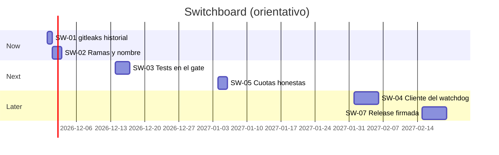

# INITIATIVES · Switchboard (antes ProjectsMenu / Mini Bar)
> **Versión pública redactada** (repo público). Los detalles explotables se sustituyeron por «detalle en projects-tools (privado)».

> **Cómo leer este documento.** Síntesis de la ronda de iniciativas del 23 nov 2026 (pedido de Jorge, t89u), consolidada por Grok Bot a partir de los aportes de The Office y de los Tech Leads (fuentes internas; detalle en projects-tools (privado)). Cada iniciativa cita sus **roles fuente** y los IDs originales para trazabilidad. Etiquetas: **[O]** observado en una fuente citada · **[H]** hipótesis por confirmar · **[EP]** evidencia pendiente. Esfuerzo: **S** ≤ ½ día · **M** 1–3 días · **L** 1–2 semanas · **XL** > 2 semanas. Prioridad: **P0** riesgo activo, va primero · **P1** este ciclo · **P2** siguiente · **P3** oportunista. Las fechas del roadmap son orientativas y no autorizan nada por sí solas.

- **Repo destino de este archivo:** `jorgedelacruz07/Switchboard`. Es **público** y no se llama `projects-menu`: el BRIEF citaba ese nombre, pero el registry enlaza `Switchboard`.
- **Ramas:**
  - por defecto, `main` (`e4a038b` «Initial public release», 13 nov);
  - `master` va +13 sin merge y `archive-main` +22;
  - existen `public-main` y un remote `archive`.
- **Qué es:** app nativa de barra de menús para macOS (Swift + AppKit + un componente Node de estado de proveedores). Muestra RAM, uso de IA etiquetado por fuente y disponibilidad pública de proveedores. Sin puerto.
- **Sin Tech Lead** en esta ronda. La evidencia viene de la auditoría del 15 nov y de los demás roles.
- **Fuentes:** AppSec (SEC-SWB-*), Platform (SWB-PLAT-*), Quality (QE-SW-*), AI & Ecosystem Scout (AIS-SW-*), Learning & Career Coach (LCC-SW-*), Product & UX (SW-00) y Content Strategist (TCS-SW-*).

## 1. Resumen ejecutivo

Proyecto de bajo riesgo de datos, pero con **repo público**. Hay que:
- **escanear el historial** en busca de datos del entorno (rutas, hostnames de la tailnet, tokens);
- **ordenar las ramas**, porque el trabajo vive fuera de la rama por defecto;
- **meter los tests** Python y Swift en `quick` y sacar los tests Swift del binario.

Después, Switchboard puede ser la **cara visible de la salud del Mini**: consumir el endpoint local del watchdog (TX-21) y el lock de toolchain (TX-18). Si se distribuye, una release firmada y notarizada.

## 2. Estado actual (con evidencia y fechas)

| Ámbito | Estado | Fuente |
|---|---|---|
| Repo | Público. `main` limpio en `e4a038b` (13 nov). `master` +13, `archive-main` +22, `public-main` y remote `archive`. | [O] AUD L62; SWB-PLAT-02 |
| Nombre | Una skill interna y un handoff todavía citan el nombre antiguo (detalle en projects-tools (privado)). | [O] AUD L19, R5 |
| Tests | 6 suites Python y 3 archivos de tests Swift que **ningún script ejecuta**. `install.sh` y `app-update.py` tienen efectos locales. Los tests Swift (`LoginTests`, `MenuTests`, `UsageTests`) viven en `Sources/` junto a `main.swift`; **[H]** acaban dentro del binario. | [V] QE-SW-01/02 |
| Monitor | `Features/ProviderStatus/test/monitor.test.js` es el único test JS. **[H]** Depende de la red. | [V]/[H] QE-SW-03 |
| Cuotas | **[EP]** Origen de los datos de cuotas por revisar (detalle en projects-tools (privado)). | SEC-SWB-03 |
| Historial público | **[EP]** No se ha escaneado con gitleaks. | SEC-SWB-01 |
| Doppler | No tiene `doppler.yaml`. | [O] AUD L151 |

## 3. Iniciativas

### SW-01 · Repo público sin datos del entorno: escaneo del historial y push protection — **P2 · S**
- **Fuentes:** SEC-SWB-01; LCC-SW-01; TX-07 (escaneo y push protection transversales).
- **Propuesta:**
  - `gitleaks detect --redact` sobre todo el historial y las ramas.
  - Revisar el README y la configuración en busca de topología (hostnames, IPs internas y rutas locales; patrones: detalle en projects-tools (privado)).
  - Activar push protection y secret scanning.
- **Aceptación:** informe de gitleaks con 0 hallazgos o con su remediación; 0 coincidencias de topología en `main`.
- **Plan para el agente:**
  1. Clon de lectura en el Mini o en el box (es público), sin fetch en el checkout activo.
  2. `gitleaks detect --redact --log-opts="--all"`.
  3. Informe sin valores.
  - **OK de Jorge:** activar las opciones del repo y cualquier reescritura de historial (force-push).

### SW-02 · Unificar ramas y nombre (`main`/`master`/`archive-main`) — **P2 · S**
- **Fuentes:** SWB-PLAT-02 (parte de ramas); TX-28; AUD R5/R11.
- **Propuesta:**
  - `git cherry main master` y `git cherry main archive-main` para ver si hay trabajo único.
  - Informe para Jorge.
  - Documentar el flujo `main` → release.
  - Corregir las referencias a `ProjectsMenu` en una skill interna y el handoff (detalle en projects-tools (privado)).
- **Aceptación:** una única rama de trabajo (la decide Jorge); informe aprobado; `rg -n ProjectsMenu` en skills/handoffs → 0.
- **OK de Jorge:** borrar o archivar ramas y el remote `archive`.

### SW-03 · Tests Python y Swift en el gate y fuera del binario — **P2 · S–M**
- **Fuentes:** QE-SW-01, QE-SW-02, QE-SW-03; TX-11.
- **Propuesta:**
  - `npm run quick` ejecuta Python + Swift + JS sin efectos fuera de `/tmp`.
  - Tests Swift a `Tests/Swift/`, con runner `swiftc … -o /tmp/sb-tests` o `Package.swift` con target de test.
  - Fixtures grabados para el monitor (sin red).
  - *Descartado:* proyecto Xcode.
- **Aceptación:** el binario sin símbolos `*Tests`; `npm test` pasa sin red; las 3 familias de tests en `quick`.

### SW-04 · Switchboard como cliente del estado de plataforma (watchdog y toolchain) — **P2 · M**
- **Fuentes:** SWB-PLAT-01; AIS-SW-01 (deriva de versiones en ámbar); LCC-SW-03 [H]; TX-21 y TX-18.
- **Propuesta:** leer el endpoint en loopback o el JSONL del watchdog: estado de servicios, exposición de red y deriva del lock. Semáforo. Sin lógica de actualización.
- **Dependencias:** TX-21 y TX-18.
- **Aceptación:** con un servicio simulado caído, el icono cambia en menos de 60 s.

### SW-05 · Cuotas sin credenciales en claro y presentadas con honestidad — **P2 · S**
- **Fuentes:** SEC-SWB-03; AIS-SW-02 (las «cuotas» no son créditos de API).
- **Propuesta:**
  - La app no lee archivos de credenciales locales (detalle en projects-tools (privado)). Leer solo del endpoint filtrado de projects-tools; si hace falta un token, va en el Llavero.
  - Etiquetas «uso según fuente X», no «créditos».
- **Aceptación:** 0 lecturas de archivos de credenciales locales (patrón de búsqueda: detalle en projects-tools (privado)); textos revisados.

### SW-06 · Puertos y proyectos leídos del registry — **P3 · S**
- **Fuentes:** SWB-PLAT-03 [H].
- **Aceptación:** `rg -n '30\d\d|51\d\d' Sources/` sin puertos fijos.

### SW-07 · Release firmada y notarizada con permisos mínimos y README de producto — **P3 · M**
- **Fuentes:** SEC-SWB-02; SWB-PLAT-02 (parte de release); LCC-SW-02; TCS-SW-01/02/03; SW-00 (accesibilidad del menú con VoiceOver).
- **Propuesta:**
  - Developer ID + `notarytool` con script local; credenciales en el Llavero o en Doppler.
  - Hardened runtime y entitlements mínimos.
  - Checksum publicado.
  - README de producto, topics y social preview.
  - Recorrido con VoiceOver.
- **OK de Jorge:** cuenta de desarrollador (coste), publicar la release y difundirla.

## 4. Mapa de fuentes → iniciativa consolidada

| ID consolidado | IDs de origen |
|---|---|
| SW-01 | SEC-SWB-01, LCC-SW-01 |
| SW-02 | SWB-PLAT-02 (ramas) |
| SW-03 | QE-SW-01, QE-SW-02, QE-SW-03 |
| SW-04 | SWB-PLAT-01, AIS-SW-01, LCC-SW-03 |
| SW-05 | SEC-SWB-03, AIS-SW-02 |
| SW-06 | SWB-PLAT-03 |
| SW-07 | SEC-SWB-02, SWB-PLAT-02 (release), LCC-SW-02, TCS-SW-01..03, SW-00 (Product) |

## 5. Roadmap

| Ola | Ventana orientativa | Iniciativas |
|---|---|---|
| **Now** | 24 nov – 12 dic 2026 | SW-01, SW-02 |
| **Next** | 14 dic 2026 – 23 ene 2027 | SW-03, SW-05 |
| **Later** | feb – mar 2027 | SW-04 (tras TX-21), SW-06, SW-07 |

## 6. Decisiones abiertas para Jorge

1. Rama de trabajo única y destino de `master`/`archive-main`/`public-main`/remote `archive` (SW-02).
2. Push protection y secret scanning, y reescritura de historial si gitleaks encuentra algo (SW-01).
3. ¿Se distribuye a terceros? Si sí: cuenta Developer ID, firma y notarización (SW-07).
4. ¿Asignar un Tech Lead o dueño? PEND-80: `ideaDesk.enabled`.

## Reglas fijas (aplican a cada paso de este documento)

1. **Solo el Mac Mini.** Todo se ejecuta y se cambia en el Mac Mini. El MacBook Air solo es puente SSH (detalle en projects-tools (privado)) y nunca se editan archivos en él.
2. **Ramas aisladas.** Una tarea = una rama o entorno aislado (según el contrato de aislamiento vigente, ver TX-13 en `_transversal`), con un solo escritor por repo. Nada de `--force`, `reset --hard`, reescritura de historial ni sobrescribir trabajo ajeno. Las lecturas de git usan `GIT_OPTIONAL_LOCKS=0`.
3. **Secretos solo en Doppler.** Nunca en archivos, commits, logs, prompts ni variables de Cloud Run en claro. Nunca se imprime un valor (`doppler secrets --only-names`, o `| shasum` si hay que comparar).
4. **Nunca leer `.env`** (ni `auth`, `config.yaml`, `state.db`, sesiones o memorias). Si un `.env` está versionado, se trata por nombre y metadatos (tamaño, commit), sin abrirlo.
5. **Destinos de despliegue:** frontends en **Firebase Hosting**, backends en **Cloud Run**. **Nunca Vercel.** Excepciones documentadas: RutinAI en el NAS; IdeaDesk, ProjectsDocs y Switchboard en el Mini.
6. **Sin OK explícito de Jorge no hay:** deploy, migración de datos, cambio de IAM/GCP/Doppler `prd`, Funnel de Tailscale, instalación, borrado de ramas/stashes, publicación o mensaje externo. Merge: solo PRs validados (QA o revisión de otro proveedor sobre el **mismo SHA**, sin conflictos), según la autorización de Jorge del 23 nov; lo demás lo decide Jorge.
7. **Quien implementa no verifica.** La revisión la hace un proveedor distinto del implementador; el veredicto vale solo para el SHA revisado.
8. **Paso 0 siempre de solo lectura:** la evidencia de este documento tiene fecha; antes de cambiar nada se reverifica. Lo que ya no aplique se marca como resuelto y no se ejecuta.
9. **Si `gh` devuelve 401, se informa y no se reintenta.** No se buscan rutas alternativas para credenciales.
